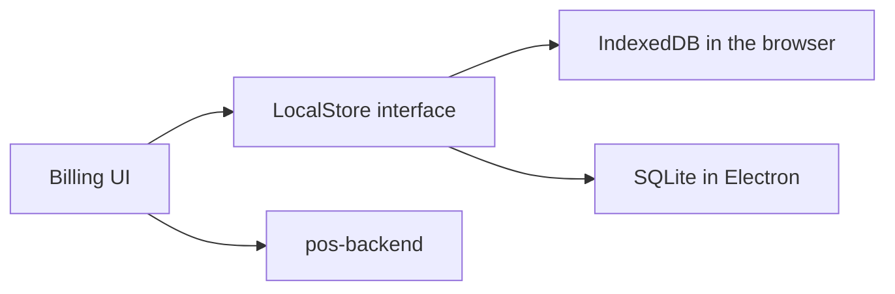

# Desktop POS architecture

This repository is the only POS client. It ships as a browser PWA and, in Phase 9, as an Electron app around the same React UI. Business Admin and Super Admin are `pos-admin-frontend`. HTTP, tenancy, pricing, and stock rules are `pos-backend`.

Read these server documents before changing sync or pricing behaviour:

- `pos-backend/docs/ARCHITECTURE.md`
- `pos-backend/docs/API.md`
- `pos-backend/docs/OFFLINE-SYNC.md`

Local behaviour that the server protocol assumes is [OFFLINE.md](OFFLINE.md). Screens are [SCREENS.md](SCREENS.md).

## Shape

```text
renderer (React, Vite)
  -> Zustand for cart, shift, and outbox status
  -> TanStack Query for online reads
  -> local store for catalog cache and outbox
  -> HTTPS to pos-backend

Electron main process (Phase 9 only)
  -> SQLite
  -> ESC/POS printer
  -> auto-update
  -> preload bridge
```

The renderer does not import Node or Electron. Browser mode uses IndexedDB through the same local-store interface the main process will implement with SQLite. A call site asks for "save outbox row". It does not open a driver.



## Stack

React, TypeScript, Vite, Tailwind CSS, React Router, Zustand, TanStack Query, Vitest. PWA plugin for the app shell. Electron is a Phase 9 dependency and is not added earlier. Decision: `pos-backend/docs/adr/007-electron-desktop-shell.md`.

## Authentication and session

Login uses `POST /api/v1/pos/auth/login`. The access token stays in renderer memory. In the browser the refresh token is the API's HttpOnly cookie. In Electron the preload bridge stores the refresh token in OS secure storage and attaches it only to the refresh request.

Bootstrap (`GET /api/v1/pos/bootstrap`) fills modules, payment methods, tax mode, stock policy, catalog version, and the terminal. The selling screen is mounted only when `pos.billing` is enabled and the user has `pos.order.create`. Other modules add panels (barcode field, customer picker, kitchen send) without a second application.

A disabled module removes its control. The client still sends the sale to the server, which recomputes the ticket.

## What the client computes

The cart shows a running total so the cashier is not waiting on a keystroke. The value is a preview. `POST /api/v1/pos/orders` returns the stored totals, and the cart replaces its preview with that response before payment completes. Offline, the preview is what gets printed and what gets queued, and the server may still adjust it on sync if the snapshot was incomplete. Complete snapshots are specified in [OFFLINE.md](OFFLINE.md).

The client does not send an on-hand quantity. It sends product ids, quantities as decimal strings, and the idempotency key.

## Environment

| Variable | Purpose |
| --- | --- |
| `VITE_API_BASE_URL` | API origin |

No database URI and no payment secret. Razorpay checkout uses `keyId` from the verify route's sibling create route.

## Hardware

Barcode scanners that act as a keyboard work in the browser and in Electron: the search field stays focused and Enter submits the code. Receipt printing in the browser uses the print dialog on the receipt view. ESC/POS and the cash drawer are Electron main-process features in Phase 9, configured from the terminal record the server already stores.

## Contract

Pinned catalog version: `2026-11-04`, from `pos-backend/docs/API.md`. Regenerate local API types when that version changes. Record the pin in `src/api/CONTRACT.md` once Phase 2 creates the source tree.
