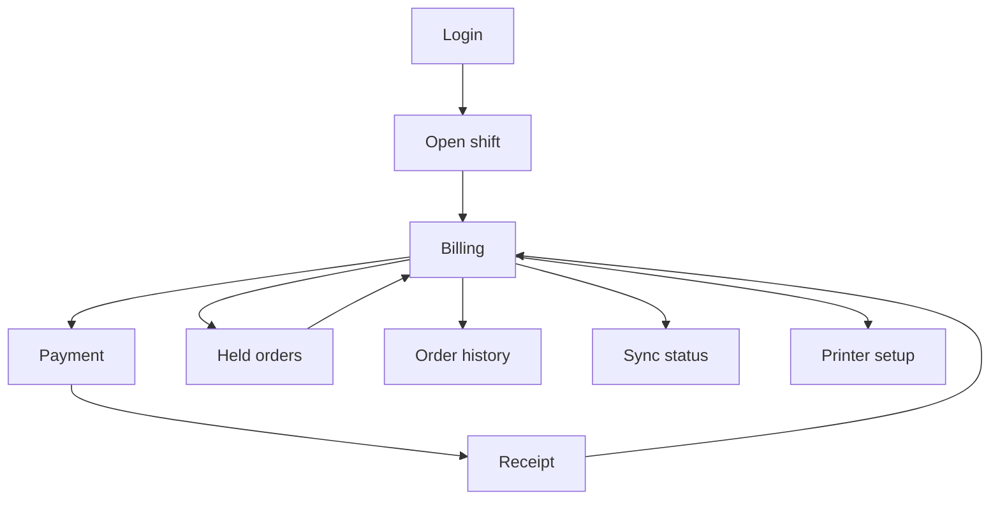

# POS screens and navigation

The selling screen is the product. Other screens exist to open a shift, finish payment, and recover from an offline queue. Admin configuration of products and recipes happens in Business Admin, not here.

## Flow

| Route | Screen | Purpose |
| --- | --- | --- |
| `/login` | Sign in | Cashier email and password. Shows a connection banner when the API cannot be reached and a previous session is missing |
| `/shift/open` | Open shift | Opening cash. Blocked until a terminal is selected |
| `/sell` | Billing | Categories, search, scan, product grid, cart |
| `/orders/held` | Held tickets | Resume a ticket from this terminal's shift |
| `/pay/:orderId` | Payment | Methods the tenant enabled. Offline shows cash only |
| `/receipt/:orderId` | Receipt | Print or return to billing |
| `/orders` | History | This terminal first, then the branch when online |
| `/sync` | Outbox | Pending, failed, and conflict rows |
| `/printer` | Printer | Browser print hint now. Device selection when Electron exists |

Closing the shift is a confirm step from the billing header, not a separate destination. It asks for counted cash and calls shift close.

## Billing layout

Wide touch screens, left to right:

1. Category rail and search. The search box is focused on entry and after each added item.
2. Product grid. Large targets, name, and selling price. Out-of-stock items stay visible and marked when the cached balance says so. The server may still accept the sale and flag an oversell.
3. Cart. Line quantity, line remove, discount control, tax summary, pay button.

Narrow screens stack the grid above the cart and keep the pay button pinned.

Keyboard, including when a scanner is not attached:

| Key | Action |
| --- | --- |
| Type while the search box is focused | Filter products |
| Enter | Add the top match or the exact barcode |
| Plus and minus | Change quantity on the selected line |
| F4 | Focus discount |
| F8 | Open payment when the cart is not empty |
| F12 | Hold the ticket |
| Escape | Clear search, then clear selection |

Touch targets on the grid and quantity controls are at least 44px. The pay button is the only filled primary button on the screen.

## Payment and receipt

Payment lists the methods from bootstrap. Cash asks for tendered amount and shows change. Split tender adds another method row until the remaining balance is zero. Partial payment appears only when module settings allow it.

Razorpay opens only when the API create-order call succeeds. The client never embeds the key secret.

The receipt shows the business name, branch, lines, tax, total, method, and either the official receipt number or the offline reference. A note on the offline receipt says the official number arrives after sync.

## States

| State | What the cashier sees |
| --- | --- |
| Loading bootstrap | A single progress line, not a blank shell |
| No products | "No products are available on this terminal yet." |
| API down, cache present | A persistent offline banner and a working grid |
| API down, cache missing | Login or sell blocked with a retry |
| Payment rejected | The cart kept, the server message shown |
| Sync conflict | A count on the header that opens `/sync` |

## Out of this app

Product setup, recipes, stock counts, expenses, employee admin, and tenant creation are not screens here. Deep links to those tasks are not added.
